<div align="center">



<br/>

<a href="https://github.com/DanielDornelas">
  
</a>

</div>

---

<h2 align="center">🧠 Sobre mim</h2>

<table align="center">
<tr>
<td width="60%" valign="top">

- 🎂 Tenho **19 anos**
- ⚡ Formado em **Técnico em Eletrônica** pela Etec Presidente Vargas
- 💻 Cursando **Análise e Desenvolvimento de Sistemas**
- 🐍 Focado em **Python** e **Banco de Dados**
- 📊 Explorando o mundo de **dados**: pipelines com Airflow e dashboards no Power BI
- 🌐 Também construo interfaces com **HTML, CSS e JavaScript**
- 🚀 Sempre evoluindo na área de tecnologia

</td>
<td width="40%" valign="top" align="center">

```python
class Daniel:
    idade = 19
    formacao = "Técnico em Eletrônica"
    curso = "ADS"
    foco = ["Python", "SQL", "Dados"]

    def status(self):
        return "aprendendo 🚀"
```

</td>
</tr>
</table>

---

<h2 align="center">🗄️ Banco de Dados</h2>

<p align="center">
  
  &nbsp;&nbsp;&nbsp;
  
  &nbsp;&nbsp;&nbsp;
  
</p>

<h2 align="center">🐍 Linguagens & Web</h2>

<p align="center">
  
  &nbsp;&nbsp;&nbsp;
  
  &nbsp;&nbsp;&nbsp;
  
  &nbsp;&nbsp;&nbsp;
  
</p>

<h2 align="center">📊 Dados & BI</h2>

<p align="center">
  
  &nbsp;&nbsp;&nbsp;
  
  &nbsp;&nbsp;&nbsp;
  
</p>

---

<h2 align="center">🔥 Status de Atividade</h2>

<p align="center">
  
</p>

<p align="center">
  
</p>

---

<h2 align="center">🌎 Onde me encontrar</h2>

<p align="center">
  <a href="https://github.com/DanielDornelas">
    
  </a>
  <a href="https://www.linkedin.com/in/daniel-da-silva-dornelas-3b9b86345/">
    
  </a>
</p>

---

<p align="center">
  ✨ Em constante aprendizado, sempre buscando evolução ✨
</p>
